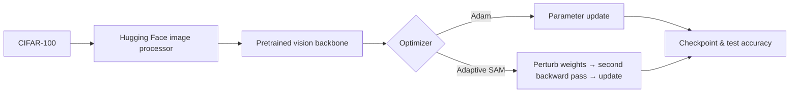

# SAM Transformer

<p align="center"></p>

<p align="center">
  <a href="https://www.python.org/"></a>
  <a href="https://huggingface.co/docs/transformers"></a>
  
</p>

**SAM Transformer** is a PyTorch research project for comparing pretrained vision architectures on CIFAR-100. It fine-tunes Vision Transformer and Swin Transformer variants with Adam or adaptive Sharpness-Aware Minimization (SAM), then evaluates saved checkpoints alongside reference ViT, Swin, and ResNet models.

## Highlights

- Fine-tunes Hugging Face image classifiers for 100 CIFAR-100 classes.
- Implements a two-step, adaptive SAM update; Adam is also supported.
- Supports ViT, CvT, Swin V2, ViT Hybrid, and ViT-MSN training configurations.
- Saves checkpoints per epoch and at the end of a run under `models/<model>/`.
- Evaluates a selected model or writes a ranked `results.json` after all configured models run.
- Offers optional Weights & Biases logging for loss, learning rate, and accuracy.

## How it works



`train.py` downloads CIFAR-100 into `data/`, applies the selected model's image processor, and configures 100 labels. SAM runs take an ascent step, calculate a second gradient pass, and then update the parameters. `eval.py` can load local SAM checkpoints or hosted reference models.

## Tech stack

| Area | Tools |
| --- | --- |
| Training | Python, PyTorch, torchvision |
| Models | Hugging Face Transformers — ViT, Swin V2, CvT, ViT Hybrid, ViT-MSN |
| Data | CIFAR-100 |
| Optimization | Adam, adaptive SAM, StepLR, cosine annealing |
| Tracking | Weights & Biases (optional) |

## Quick start

```bash
python -m venv venv
pip install -r requirements.txt
```

Inspect the CLI and run the tracked ViT + SAM configuration:

```bash
python train.py --help
python train.py --model vit --batch_size 32 --epochs 5 --lr 0.01 --optimizer sam
```

Evaluate one configured model, or all configured models to regenerate `results.json`:

```bash
python eval.py --model VIT
python eval.py
```

> The scripts download CIFAR-100 and pretrained model assets when first needed. CUDA is used automatically when available.

## Project structure

```text
.
├── train.py             # fine-tuning loop, schedulers, checkpointing
├── eval.py              # CIFAR-100 evaluation and result export
├── model.py             # Hugging Face classifier wrapper
├── sam.py               # adaptive SAM optimizer implementation
├── results.json         # saved benchmark output
├── cifar100_classes.json
├── report/              # accompanying course report and paper assets
└── assets/banner.svg    # repository banner
```

## Results & learnings

The checked-in `results.json` records CIFAR-100 accuracies for five configured runs. Its top entry is **VIT-ASAM: 0.9285**, followed by **SWIN-ASAM: 0.9202**. The accompanying report describes these as experimental results and notes that the Adam/ASAM comparison was not a fully balanced hyperparameter study. Treat the values as this repository's reported benchmark snapshot, not a general performance claim.

## Reference

The SAM optimizer implementation is adapted from the [official SAM implementation](https://github.com/davda54/sam), based on *Sharpness-Aware Minimization for Efficiently Improving Generalization*.

---

Leiden University MSc Computer Science (AI) course project.
